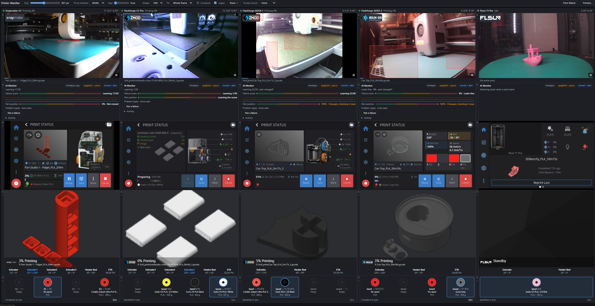
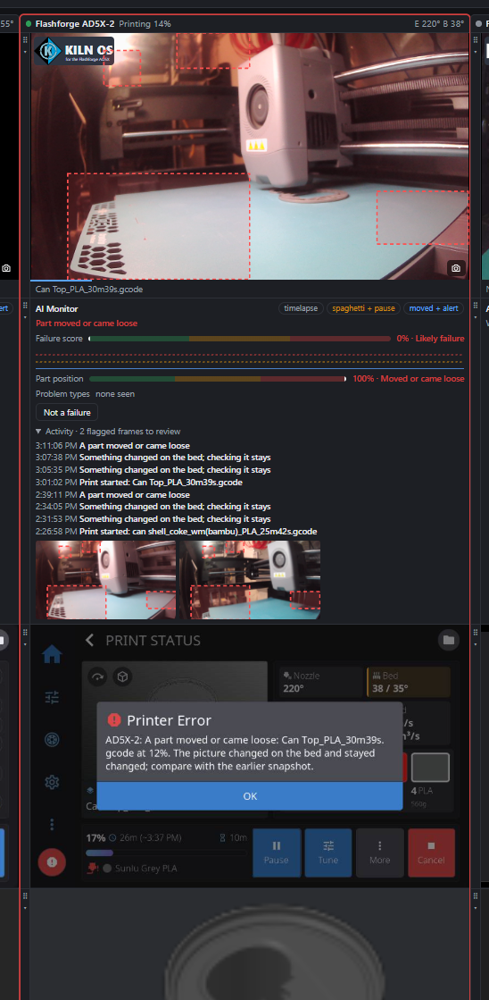
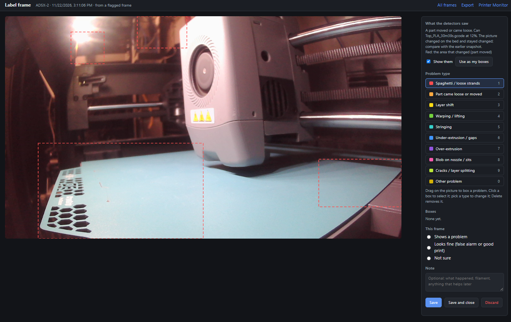

# PrintWarden

One app that watches all your Klipper/Moonraker printers from a web page, renders their timelapses off the printer, and looks for failed prints with AI.

It brings three earlier projects together: Printer Monitor (the multi-printer page), Print Watch (failure detection) and TimelapseOffload (timelapse rendering). It runs in Docker on another machine. Nothing is installed on the printers.



## What it does

- **Watches every printer on one page** at `http://<docker host>:8095/`: live camera, remote screen, a Mainsail-style card with progress, ETA and temperatures, and the spool in each lane (from Moonraker `lane_data`, AFC and Spoolman).
- **Renders timelapses off the printer.** When a print finishes, it downloads the moonraker-timelapse frames, renders them with ffmpeg and saves the video to a network share. Printers that render on-device (Snapmaker U1) have their finished videos copied instead.
- **Looks for failures while printing**: Obico's spaghetti model, a moved-or-loose-part check, and our own problem-type detector (trial). Each can alert (Discord, printer console) or alert and pause the print.
- **Collects training data.** Capture frames from any camera, label problems on the AI Training page, and export a YOLO dataset to train the next detector.

## Install

PrintWarden is a ready-made image, `ghcr.io/diehardave/printwarden` (amd64 and arm64, so a Raspberry Pi 4/5 works too). One command:

```sh
docker run -d --name printwarden --restart unless-stopped -p 8095:8095   -e TZ=Europe/Berlin   -v printwarden-data:/data -v printwarden-output:/output   ghcr.io/diehardave/printwarden:latest
```

Then open `http://<docker host>:8095/`, click **Printers…** and add your printers (or **Find printers** to scan a subnet). They are saved in the `/data` volume. Rendered timelapses land in the `/output` volume.

Portainer, Unraid, TrueNAS or Synology: use the same image, publish port 8095 and mount two volumes, `/data` and `/output` (point `/output` at a share if you want the videos there).

### Without Docker (native install)

On Debian, Ubuntu, Raspberry Pi OS (64-bit), Fedora, Arch or openSUSE:

```sh
curl -fsSL https://raw.githubusercontent.com/DIEHARDave/PrintWarden/main/install.sh | sudo bash
```

It installs Python 3 and ffmpeg from the distro, puts PrintWarden in a virtualenv under `/opt/printwarden`, keeps its data in `/var/lib/printwarden` and runs it as the systemd service `printwarden` (user `printwarden`). Logs: `journalctl -u printwarden -f`. Run it again to update; settings and data stay.

Options: `--output /mnt/nas/timelapses` (where videos go; default `/var/lib/printwarden/timelapses`), `--port 8096`, `--version v0.3.0`, `--uninstall` (keeps data; add `--purge` to delete it). From a clone, `sudo ./install.sh` installs that checkout. Paths live in `/etc/printwarden/printwarden.env`, the optional `config.yaml` in `/etc/printwarden/`.

Needs Python 3.10 or newer and a 64-bit CPU (x86-64 or ARM64) for failure detection; on 32-bit ARM the page and timelapses still work. Fedora/RHEL need RPM Fusion and openSUSE needs Packman for ffmpeg.

### With Docker Compose

```sh
git clone https://github.com/DIEHARDave/PrintWarden.git
cd PrintWarden
cp .env.example .env      # optional: timezone, NAS share
docker compose up -d
docker compose logs -f
```

- **Videos on a NAS (SMB share):** set `COMPOSE_FILE=docker-compose.yml:docker-compose.nas.yml` and the `NAS_*` lines in `.env`. The Docker host needs `cifs-utils`.
- **Printers in a file instead of the page:** `mkdir -p config && cp config.example.yaml config/config.yaml`, edit it, then `docker compose restart`. Printers saved on the page are kept on top of it.
- **Update:** `docker compose pull && docker compose up -d`. Pin a version with `image: ghcr.io/diehardave/printwarden:0.2.0`.
- **Build from source:** `docker compose up -d --build`.

### Requirements

- Printers running Moonraker. For timelapse rendering: [moonraker-timelapse](https://github.com/mainsail-crew/moonraker-timelapse) installed and **enabled**, and the slicer emitting `TIMELAPSE_TAKE_FRAME` per layer.
- The Docker host can reach each printer's Moonraker port (7125). If Moonraker doesn't trust the host's address, set `api_key` for that printer.
- The page talks to Moonraker from your browser, so each printer's `moonraker.conf` has to allow the page's origin:

  ```ini
  [authorization]
  cors_domains:
      http://your-docker-host:8095
  ```

  Spoolman needs CORS allowed as well (`SPOOLMAN_CORS_ORIGIN`).

Tested with Zmod (Flashforge AD5X / Creator 5), Kiln OS, Snapmaker U1, the FLSUN T1 and a stock Klipper/Mainsail Pi.

## The page



- **A column per printer** with Camera, Screen, Card, Spools and AI Monitor rows. The slim bar on the left of each row has a grip (drag it onto another row to move it) and a fold arrow (fold the row to a thin strip; it keeps running). The toolbar's **Rows** menu switches rows on or off; rows switched off stop their streams and polling. Every row is as tall as its tallest copy, so rows and columns stay level. Click a tile to enlarge it.
- **Fit to window**: **Width** sizes the tiles to fill the window's width in one line and lets the page scroll down; **Height** fits everything in the window without scrolling.
- **Live video**: the browser plays each printer's MJPEG stream straight from the printer (camera-streamer's WebRTC entry is swapped for its `stream.mjpg`). The detectors' boxes from the last checked snapshot are drawn over it, in the AI Training page's problem-type colors: red spaghetti (Obico), orange dashed moved part, and each named problem type in its own color. The tile border turns orange or red on an alert. Each open page pulls one stream per printer, so keep it to a few viewers on weak printer boards.
- **AI Monitor card**: a timelapse chip and two detection chips, **spaghetti** and **moved**; click one to step it through off, alert and alert + pause (saved on the server at once). Below them: the failure score and its history, the part-position check, the problem types seen, **Not a failure** (silences alerts for the rest of that print; **Undo** turns them back on), **Resume** while the print is paused (asks first, then sends Moonraker's resume), and this print's newest flagged frames with what was detected drawn on them. The state line and **All N frames** open the print's flagged frames on the AI Training page.
- **Spools row**: one entry per physical lane, built from Moonraker's `lane_data` and AFC lane state. Names, colors and weights come from Spoolman; empty lanes show as Empty. **Sync** (optional) sets each loaded spool's Spoolman location to `<printer> <lane>` and clears out-of-date ones; a spool claimed by two printers is flagged and skipped.
- **Printers…**: each printer's host, camera and screen (picked from its Moonraker webcam list, or **Custom…**), the Spoolman URL, and under each row the server settings: **Watch** (the server handles this printer), timelapse handling, both detectors, sensitivities, and under ⋯ the server name, port, API key, frame download and copy-mode options. The section below holds Find printers and the settings for all printers (check interval, threads, Discord webhook, console message, test alert). Save writes the server side first, and only when something changed.

The page has no login; keep the port on your LAN, like Moonraker itself. The Discord webhook URL never leaves the server once saved: `GET /api/settings` only reports `discord_webhook_set`, a save without `discord_webhook` keeps it and an empty one removes it.

The page layout and printer list are kept in your browser, per address. **Printers… → Export…** and **Import…** move them to another browser. The printers in `DEFAULT_PRINTERS` at the top of the script in `printwarden/web/monitor.html` are the author's own; replace them or set yours up in the page. Server settings are saved in `/data/settings.json`, which from then on replaces the `printers:` list in `config.yaml`. Delete that file to go back to `config.yaml`.

## Timelapses

### How it works

1. Connects to each printer's Moonraker websocket and watches `print_stats`.
2. When a print goes from printing to complete, downloads the frames from Moonraker's `timelapse_frames` file root (read-only HTTP; no SSH or printer-side install).
3. Renders with ffmpeg using the printer's own timelapse settings from Mainsail/Fluidd: frame rate or variable fps/target length, rotation and flip, duplicate last frame, preview image.
4. Saves `timelapse_<file>_<date>.mp4` and a preview `.jpg` to `<output>/<printer>/`.
5. With `delete_frames_after_render` (on by default), removes the frames from the printer once the video is safely on the NAS, where the printer allows it (see below).

On connect it turns off moonraker-timelapse's `autorender` on the printer (`disable_printer_render`). Turn it back on in Mainsail/Fluidd (Settings → Timelapse) if you remove PrintWarden.

If the container was down when a print finished, it renders the leftover frames when it reconnects (`catch_up`). The frames stay on the printer until the next print starts, when moonraker-timelapse deletes them.

### Save Frames (printer-made zips)

If a printer's timelapse settings have **Save Frames** on, moonraker-timelapse writes `timelapse_<file>_<date>_frames.zip` to its `timelapse` folder when a print completes, even with autorender off. PrintWarden then uses that zip: it waits for the zip to finish writing, downloads it in one request, renders it and saves the video as `timelapse_<file>_<date>.mp4`. Once the video is on the NAS it deletes the zip from the printer (`delete_saved_frames`, on by default). Zips don't get wiped when the next print starts, unlike the loose frames, so if the container was down for several prints, every one of them still gets rendered when it reconnects.

Cancelled prints get no zip. With `render_cancelled` they, and printers with Save Frames off, use the frame download below. moonraker-timelapse registers its loose-frames folder read-only. Where that folder sits inside a writable root (Zmod puts it at `gcodes/timelapse/tmp`), PrintWarden deletes the frames through that root after rendering, never while a print is running. Elsewhere (e.g. `printer_data/timelapse_frames` on the T1 or Kiln OS) they stay until the plugin clears them at the next print start.

### Fetching frames as a zip

By default each frame is its own HTTP request, about 1000 for a long print. With `fetch: zip` on a printer, Moonraker's `/server/files/zip` packs the frames into one uncompressed zip (store only, so almost no printer CPU) in `zip_root` (default `timelapse`; the frames root itself is read-only). PrintWarden downloads it in one request and deletes it from the printer. This helps on printers whose file serving drops individual requests (the Creator 5). The printer needs free space in `zip_root` for one extra copy of the frames (checked first). If anything goes wrong, it falls back to frame-by-frame.

### Sync mode (printers that render on-device)

Some printers render timelapses themselves and never expose the raw frames — the Snapmaker U1, for example, renders on the printer and only publishes finished MP4s. There's nothing to offload, so a printer set to `mode: sync` is instead polled on an interval, and any new videos in its file root are copied to `<output>/<printer>/`. Set `delete_after_sync: true` to also remove them from the printer after a successful copy (off by default). See the U1 block in [config.example.yaml](config.example.yaml).

## Failure detection

While a printer is printing, PrintWarden grabs a webcam snapshot every 10 s (the printer's camera from Moonraker's webcam list) and runs [Obico](https://github.com/TheSpaghettiDetective/obico-server)'s open-source failure-detection model on it, on the CPU, inside the container. Scoring follows Obico's own algorithm: each frame's detections are summed, smoothed, and compared against a long-running baseline for that printer, so a printer whose camera always shows some clutter doesn't keep tripping it. The first 30 checks of each print (5 minutes) only learn what the print looks like.

Set per printer (`detect:` in config, or on the web page):

- `off`: no checks (the default).
- `alert`: when the score crosses the warning level, then again at the failure level, send an alert.
- `pause`: alert at the warning level, and at the failure level pause the print through Moonraker (`/printer/print/pause`). Pausing is never cancelling: resume it from Mainsail/Fluidd/the screen if it was a false alarm. After a resume the printer gets the 5-minute grace period again.

Alerts go to a Discord webhook (`notify.discord_webhook`, with the snapshot attached) and, with `notify.console`, to the printer's console as a `RESPOND` message. The frame that triggered each alert or pause is kept in `/data/flagged/<printer>/` and shown on the page. On the page, **Not a failure** silences alerts for the rest of that print. `sensitivity` (default 1.0) scales the score: raise it to catch failures sooner, lower it if a printer gives false alarms.

### Moved or loosened parts

The model only knows what loose strands look like. A part that came off the bed, tipped over or was pushed aside still looks like a clean part, so it scores nothing until spaghetti piles up. A second check watches for that, on the same snapshots, with its own per-printer setting `motion:` (`off`, `alert` or `pause`, default `alert`; an old `true`/`false` reads as `alert`/`off`), separate from the spaghetti `detect:` setting:

- It compares the median of the last 2 minutes of snapshots with the median of the 2 minutes before. The median removes the moving toolhead; spots the toolhead kept passing over are left out rather than guessed at.
- Small shifts are tolerated, so the bed lowering, a delta effector rising and new layers growing do not count. A change of light or a bumped camera (most of the picture at once) is skipped.
- A change must cover more than about 1.2% of the picture (scaled by `motion_sensitivity`) and is then only a candidate. It's confirmed once it is still there in frames where the toolhead, read from Klipper, is at least 40 mm from where it was when the change appeared, so a toolhead that sat in one place for a few minutes is not taken for a new object. A move is usually reported 2 to 4 minutes after it happened.
- The alert carries the current snapshot and one from a few minutes earlier (both kept in `/data/flagged/`), and the page outlines the changed area in orange.

Per printer: `motion_sensitivity` (default 1.0; higher catches smaller changes). It cannot see what the toolhead keeps covering, and a slow drift over many minutes is not caught. Checks start once the print is on the plate: from layer 2 when the slicer sends layer info (`SET_PRINT_STATS_INFO`, OrcaSlicer/PrusaSlicer/SuperSlicer do), otherwise after 4 minutes of Klipper print time (which counts from the first extrusion), so heating, probing and purging are not watched. The first 4 minutes after that, and after a resume, only learn the scene.

The model (~200 MB) is downloaded from obico.io into `/data/models` on first use and checked against its SHA-256. One check takes about 0.2 s of CPU on a desktop and somewhat more on a small VM; checks run one at a time across all printers. The model is licensed AGPL-3.0 by Obico and is not part of this repository.

Snapshots are fetched from the printer's web port (the `snapshot_url` in its webcam config, relative URLs on port 80). Pick a different camera per printer with `webcam:`.

### Problem types (trial)

A second model, trained by us (`tools/train_detector.py` on public CC BY 4.0 Roboflow sets plus frames labelled here), boxes spaghetti, stringing, under- and over-extrusion, warping, blobs, cracks and loose parts on the same snapshots. It is downloaded (about 11 MB, checked against its SHA-256) from this project's [v0.3.0 release](https://github.com/DIEHARDave/PrintWarden/releases/tag/v0.3.0) into `<data>/models/faults.onnx` the first time a printer has detection on. A `faults.onnx` you train yourself and put there is used as is and never replaced (a new file is picked up at the next check). `detection.problem_types: false` in config.yaml turns it off. It is in trial: it only alerts, never pauses, once a type stays above 50% for 3 checks in a row, once per type per print, and "Not a failure" silences it like the rest. The page draws its boxes in that type's color from the AI Training page, with the type and confidence, and the detection row lists what it sees now. About 0.2 s per check on a 2-vCPU host.

`tools/check_false_alarms.py` runs a model over our own timelapse videos and reports how often it would have flagged a frame; anything it finds on a good print is a false alarm, and those frames belong on the AI Training page as "looks fine" before the next training run.

## Training data



To build our own failure examples, the camera button at the bottom right of each watched printer's camera on the page takes a fresh frame from that printer and opens it on the AI Training page (`/label/`) in a new tab. Drag boxes round problems and pick their type (spaghetti, part came loose or moved, layer shift, warping, stringing, under-extrusion, over-extrusion, blob, cracks, other; keys 1–9 and 0), say whether the frame shows a problem, looks fine or you are not sure, add a note and save. Clicking a flagged frame in the AI Monitor card copies that alert frame to the AI Training page, which is how false alarms get recorded.

Frames are kept in `/data/training/` (`<id>.jpg` + `<id>.json` with printer, time, print file and progress, verdict, boxes in pixels and the note). `/label/` lists them, and `/label/?frames=<printer>` shows every flagged frame of a printer's current (or last) print, whose start comes from Klipper's `total_duration`; **Export** (`/api/training/export.zip`) downloads the labelled ones as a YOLO dataset (`images/`, `labels/`, `classes.txt`; a "fine" frame has an empty label file) plus the JSON records.

## Render on demand

Render whatever frames are on a printer right now, even if they were rendered before:

```sh
docker compose run --rm printwarden render T1
```

## Configuration

See [config.example.yaml](config.example.yaml). Output quality is set there (`ffmpeg.crf`, `ffmpeg.preset`); moonraker-timelapse's `constant_rate_factor` and `extraoutputparams` are ignored, since those are tuned for the printer's CPU.

## Not supported

Printers without moonraker-timelapse and without a Moonraker file root of finished videos: Bambu, stock Creality/Anycubic. (The Snapmaker U1 renders on-device but exposes its videos over Moonraker, so it works in `sync` mode.)

## History

PrintWarden replaces the [printer-monitor](https://github.com/DIEHARDave/printer-monitor) and TimelapseOffload repositories, whose histories are merged in here. The old Print Watch page at `/watch/` now redirects to the main page.

### Training data

The full dataset the shipped model (v4) was trained on is on the same release: [printwarden-training-v4.zip](https://github.com/DIEHARDave/PrintWarden/releases/download/v0.3.0/printwarden-training-v4.zip) (about 670 MB, YOLO format: `train/`, `valid/`, `test/`, `data.yaml` with the 10 problem types, `ATTRIBUTION.txt`). Unzip it, add your own frames exported from the AI Training page, and train with `tools/train_detector.py`.

It combines these CC BY 4.0 sets from Roboflow Universe, relabelled to our problem types:

- [All_Anomalies](https://universe.roboflow.com/3d-printer-failure/all_anomalies-rfe61/dataset/1) by 3d-printer-failure
- [FDM](https://universe.roboflow.com/3d-printer-failure/fdm-w6znp-qnbzd/dataset/2) by 3d-printer-failure
- [3D printing failure](https://universe.roboflow.com/3d-printing-failure/3d-printing-failure/dataset/1) by 3d-printing-failure

plus frames from our own printers labelled on the AI Training page, released under CC BY 4.0 as well.

## License

GPL-3.0. Obico's failure-detection model is AGPL-3.0, downloaded at first use and not part of this repository. Our problem-type model is a YOLO11n fine-tune (Ultralytics, AGPL-3.0) and is AGPL-3.0 too; it is downloaded from the release, not part of the repository. The training data is CC BY 4.0 (see above).
